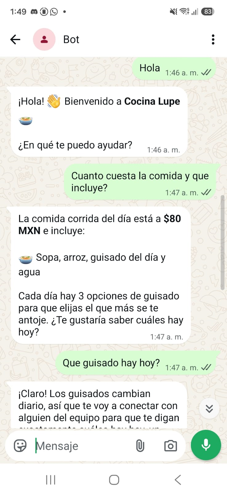
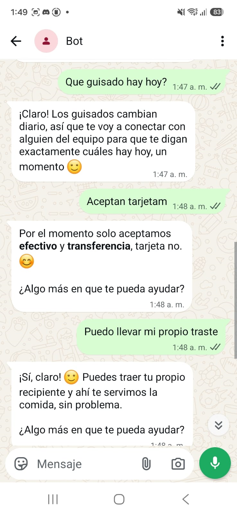

# Agente de WhatsApp con IA para negocios locales

Plantilla reutilizable de un asistente de WhatsApp que atiende a los clientes de un negocio pequeño usando la API de Claude. Toda la información del negocio (horarios, precios, preguntas frecuentes, cuándo pasar con una persona) vive en **un solo archivo JSON**, así que la misma base de código sirve para cualquier negocio cambiando ese archivo.

Ejemplo incluido: **Cocina Lupe**, una cocina económica.

> **English summary:** WhatsApp Cloud API webhook + Claude API. A per-business JSON file drives the system prompt (tone, hours, prices, FAQs, human-escalation rules). Node.js / Express. Includes webhook signature validation, retry de-duplication and per-user conversation memory.

**Stack:** Node.js · Express · WhatsApp Cloud API · Claude API (Anthropic)

## Demo

Conversación real de prueba con el bot (WhatsApp Cloud API + Claude):

<p>
  
  
</p>

## Cómo funciona

```
Cliente en WhatsApp
        │
        ▼
Meta (WhatsApp Cloud API) ──POST /webhook──▶ server.js
                                               │ 1. valida la firma de Meta
                                               │ 2. ignora reintentos duplicados
                                               │ 3. recupera el historial del cliente
                                               ▼
                                          Claude API  ◀── system prompt construido
                                               │          desde config/*.json
                                               ▼
        ◀──────── respuesta por WhatsApp ──────┘
```

- **Un archivo por negocio:** `config/business-context.json` define nombre, tono, horarios, catálogo, preguntas frecuentes y los casos en que el bot debe escalar a una persona.
- **Reglas del prompt:** responde solo con la información del archivo, es breve (estilo WhatsApp), recopila datos de pedidos paso a paso y nunca inventa precios ni disponibilidad.
- **Memoria por cliente:** recuerda los últimos 10 mensajes de cada número.

## Requisitos

- [Node.js](https://nodejs.org) 18 o superior
- Una API key de [Anthropic](https://console.anthropic.com)
- Una app de [Meta for Developers](https://developers.facebook.com) con el producto WhatsApp
- [ngrok](https://ngrok.com) (o cualquier servicio que exponga tu servidor con HTTPS) para desarrollo

## Instalación

```bash
git clone https://github.com/matks2222/whatsapp-ai-agent.git
cd whatsapp-ai-agent
npm install
cp .env.example .env     # en Windows: copy .env.example .env
```
Llena el `.env`:

| Variable | Descripción |
|---|---|
| `ANTHROPIC_API_KEY` | Clave de la API de Anthropic |
| `WHATSAPP_TOKEN` | Token de acceso de WhatsApp Cloud API |
| `WHATSAPP_PHONE_NUMBER_ID` | ID del número de WhatsApp (API Setup en Meta) |
| `WHATSAPP_VERIFY_TOKEN` | Texto que tú inventas; debe coincidir con el configurado en el webhook |
| `WHATSAPP_APP_SECRET` | App Secret de Meta; activa la validación de firma (recomendado) |
| `BUSINESS_CONFIG` | (Opcional) Nombre del JSON dentro de `config/` |
| `ENABLE_TEST_ROUTE` | (Opcional) `true` habilita `POST /test` solo para pruebas locales |
| `PORT` | (Opcional) Puerto, 3000 por defecto |

**Nunca subas el `.env` al repositorio.**

## Uso

**1. Probar el "cerebro" sin WhatsApp** (con `ENABLE_TEST_ROUTE=true`):

```bash
npm start
```

En otra terminal (PowerShell):

```powershell
Invoke-RestMethod -Uri http://localhost:3000/test -Method Post -ContentType "application/json" -Body '{"mensaje":"Hola, cuánto cuesta la comida?"}'
```

**2. Conectarlo a WhatsApp:**

1. Inicia el túnel: `ngrok http 3000` y copia la URL `https://...ngrok-free.app`.
2. En Meta: WhatsApp → Configuration → Webhook:
   - Callback URL: `https://TU-URL/webhook`
   - Verify token: el de tu `.env`
   - Suscríbete al campo **messages**.
3. Agrega tu celular como número de prueba y escríbele al número de WhatsApp de la app.

## Adaptarlo a otro negocio

1. Copia `config/business-context.json` a `config/mi-negocio.json`.
2. Edita nombre, tono, horarios, catálogo, preguntas frecuentes y reglas de escalamiento.
3. En el `.env`: `BUSINESS_CONFIG=mi-negocio.json`.

## Seguridad

- Validación de la firma `X-Hub-Signature-256` de Meta (con `WHATSAPP_APP_SECRET`).
- Deduplicación de mensajes por ID (Meta reintenta entregas lentas).
- La ruta `/test` está desactivada por omisión.
- Las claves viven solo en variables de entorno.

## Limitaciones conocidas

- La memoria de conversación está en RAM: se pierde al reiniciar.
- Solo procesa texto; a audios e imágenes responde que no los puede leer.
- "Escalar a una persona" hoy solo se lo dice al cliente; todavía no avisa al dueño.
- El bot no conoce información que cambia a diario (por ejemplo, el guisado del día).
- El token temporal de Meta dura 24 horas; para uso real se necesita un token permanente.

## Trabajo a futuro

- Notificar al dueño por WhatsApp con un resumen cuando se escala un caso.
- Que el dueño pueda actualizar información diaria (menú del día) y el bot la lea.
- Guardar conversaciones en base de datos.
- Pruebas automatizadas del armado del prompt y del historial.
- Despliegue en Google Cloud Run.

## Licencia

MIT. Ver [LICENSE](LICENSE).
